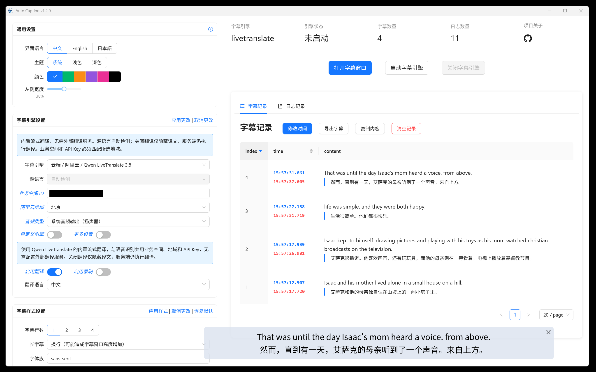
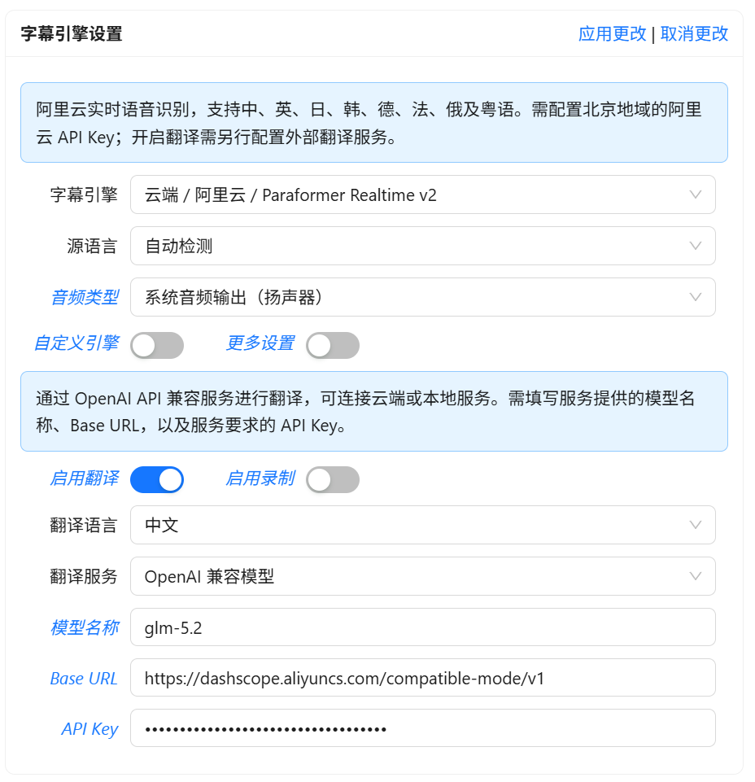
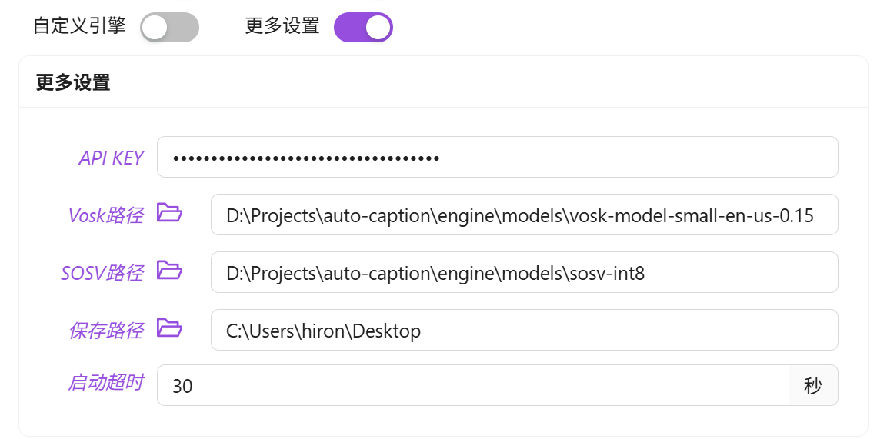
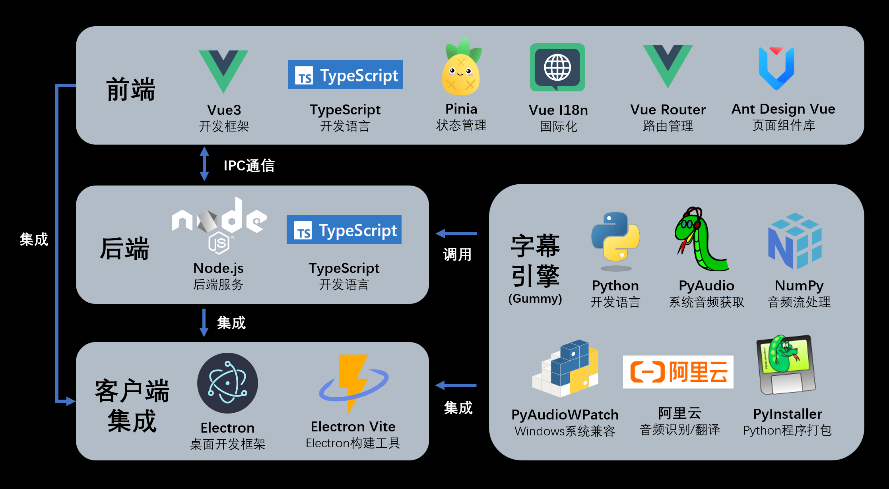

<div align="center" >
    
    <h1 align="center">auto-caption</h1>
    <p>Auto Caption 是一个跨平台的实时字幕显示软件。</p>
    <p>
      <a href="https://github.com/HiMeditator/auto-caption/releases"></a>
      <a href="https://github.com/HiMeditator/auto-caption/issues"></a>
      
      
      
    </p>
    <p>
        | <b>简体中文</b>
        | <a href="./README_en.md">English</a>
        | <a href="./README_ja.md">日本語</a> |
    </p>
    <p><i>当前软件版本：v1.2.0。更新内容详见<a href="./docs/CHANGELOG.md">更新日志</a>。</i></p>
</div>



## 📥 下载

软件下载：[GitHub Releases](https://github.com/HiMeditator/auto-caption/releases)

Vosk 模型下载：[Vosk Models](https://alphacephei.com/vosk/models)

SOSV 模型下载：[ Shepra-ONNX SenseVoice Model](https://github.com/HiMeditator/auto-caption/releases/tag/sosv-model)

## 📚 相关文档

[字幕引擎独立使用与构建](./engine/README.md)

[Auto Caption 用户手册](./docs/user-manual/zh.md)

[字幕引擎说明文档](./docs/engine-manual/zh.md)

[更新日志](./docs/CHANGELOG.md)

## 👁️‍🗨️ 预览

https://github.com/user-attachments/assets/9c188d78-9520-4397-bacf-4c8fdcc54874

## ✨ 特性

- 生成音频输出或麦克风输入的字幕
- 支持调用本地 Ollama 模型、云端 OpenAI 兼容模型、或云端 Google 翻译 API 进行翻译
- 跨平台（Windows、macOS、Linux）、多界面语言（中文、英语、日语）支持
- 丰富的字幕样式设置（字体、字体大小、字体粗细、字体颜色、背景颜色等）
- 灵活的字幕引擎选择（阿里云 Paraformer 云端模型、GLM-ASR 云端模型、本地 Vosk 模型、本地 SOSV 模型等、还可以自己开发模型）
- 多语言识别与翻译（见下文“⚙️ 自带字幕引擎说明”）
- 字幕记录展示与导出（支持导出 `.srt` 和 `.json` 格式）

## 📖 基本使用

软件已经适配了 Windows、macOS 和 Linux 平台。测试过的主流平台信息如下：

| 操作系统版本        | 处理器架构 | 获取系统音频输入 | 获取系统音频输出 |
| ------------------ | ---------- | ---------------- | ---------------- |
| Windows 11 24H2    | x64        | ✅               | ✅                |
| macOS Sequoia 15.5 | arm64      | ✅ [需要额外配置](./docs/user-manual/zh.md#macos-获取系统音频输出)     | ✅                |
| Ubuntu 24.04.2     | x64        | ✅               | ✅                |

macOS 平台和 Linux 平台获取系统音频输出需要进行额外设置，详见 [Auto Caption 用户手册](./docs/user-manual/zh.md)。

下载软件后，需要根据自己的需求选择对应的模型，然后配置模型。

|                                                              | 准确率 | 实时性 | 部署类型          | 支持语言   | 翻译       | 备注                                                       |
| ------------------------------------------------------------ | -------- | ------------- | ---------- | ---------- | ---------------------------------------------------------- | ---------------------------------------------------------- |
| [Qwen LiveTranslate 3.8](https://help.aliyun.com/zh/model-studio/qwen3-8-livetranslate-flash-realtime) | 很好😊 | 很好😊 | 云端 / 阿里云 | 自动检测 | 自带翻译 | 收费，计费规则见模型链接 |
| [Paraformer Realtime v2](https://help.aliyun.com/zh/model-studio/paraformer-real-time-speech-recognition-python-sdk) | 很好😊 | 很好😊 | 云端 / 阿里云 | 8 种语言（含粤语） | 需额外配置 | 收费，约 0.864 CNY / 小时 |
| [glm-asr-2512](https://docs.bigmodel.cn/cn/guide/models/sound-and-video/glm-asr-2512) | 很好😊 | 较差😞 | 云端 / 智谱 AI | 4 种 | 需额外配置 | 收费，约 0.72CNY / 小时 |
| [Vosk](https://alphacephei.com/vosk)                         | 较差😞    | 很好😊 | 本地 / CPU    | 超过 30 种 | 需额外配置 | 支持的语言非常多                                           |
| [SOSV](https://k2-fsa.github.io/sherpa/onnx/sense-voice/index.html) | 一般😐    | 一般😐 | 本地 / CPU    | 5 种       | 需额外配置 | 仅有一个模型                                               |
| 自己开发                                                     | 🤔        | 🤔      | 自定义        | 自定义     | 自定义     | 根据[文档](./docs/engine-manual/zh.md)使用 Python 自己开发 |

Qwen LiveTranslate 自带翻译；其他字幕引擎开启翻译时需要配置翻译服务。

### 配置翻译模型



> 注意：翻译不是实时的，翻译模型只会在每句话识别完成后再调用。

#### Ollama 本地模型

> 注意：使用参数量过大的模型会导致资源消耗和翻译延迟较大。建议使用参数量小于 1B 的模型，比如： `qwen2.5:0.5b`, `qwen3:0.6b`。

使用该模型之前你需要确定本机安装了 [Ollama](https://ollama.com/) 软件，并已经下载了需要的大语言模型。在“翻译服务”中选择 `Ollama 本地模型`，再填写模型名称即可；Ollama 会使用本机默认服务地址。

#### OpenAI 兼容模型

如果觉得本地 Ollama 模型的翻译效果不佳，或者不想在本地安装 Ollama 模型，那么可以在“翻译服务”中选择 `OpenAI 兼容模型`，并分别填写模型名称、Base URL 和 API Key。

以下是一些模型提供商的 `Base URL`：
- OpenAI: https://api.openai.com/v1
- DeepSeek：https://api.deepseek.com
- 阿里云：https://dashscope.aliyuncs.com/compatible-mode/v1

API Key 需要在对应的模型提供商处获取。

#### Google 翻译 API

> 注意：Google 翻译 API 在无法访问国际网络的地区无法使用。

无需任何配置，联网即可使用。

## ⚙️ 自带的语音识别模型

目前软件自带 5 个语音识别模型。它们的使用方法和介绍如下。

#### 使用 Qwen LiveTranslate

Qwen LiveTranslate 使用 `qwen3.8-livetranslate-flash-realtime`，在同一个 WebSocket 会话中流式返回原文和译文，无需配置外部翻译服务。默认仍为 Paraformer。选择此引擎后填写业务空间 ID、地域（北京或新加坡），并在更多设置中填写该业务空间和地域的阿里云 API Key；也可使用 `DASHSCOPE_WORKSPACE_ID` 和 `DASHSCOPE_API_KEY` 环境变量。源语言自动检测，界面提供中、英、日、韩、德、法、俄、西、意作为翻译目标语言。音频上传为 16kHz、16bit、单声道 PCM，仅输出文字，不播放翻译语音。关闭翻译仅隐藏译文，服务端仍执行翻译；只需要识别时建议选择 Paraformer。

[API / WebSocket](https://help.aliyun.com/zh/model-studio/qwen3-8-livetranslate-flash-realtime)

#### 使用 Paraformer Realtime v2

默认引擎为阿里云 `paraformer-realtime-v2`，通过 DashScope Recognition SDK 双向流式识别。上传音频为 16kHz、16bit、单声道 PCM；支持中文、英文、日语、韩语、德语、法语、俄语及粤语，`auto` 不指定语言提示。模型不提供内置翻译；开启翻译后需配置 Ollama、OpenAI 兼容服务或 Google 翻译，完整句子返回后异步翻译。设置中的阿里云 API Key 或 `DASHSCOPE_API_KEY` 环境变量用于鉴权（所有平台）；CLI 参数为 `--dashscope_api_key`。当前使用北京地域默认端点，API Key 必须匹配该地域。旧 Gummy 引擎选项和 API Key 自动迁移，旧西班牙语/意大利语源语言改为自动检测；旧自定义命令需手动更新。详见[阿里云官方 SDK 文档](https://help.aliyun.com/zh/model-studio/paraformer-real-time-speech-recognition-python-sdk)。

#### 使用 GLM-ASR 模型

使用前需要获取智谱 AI 平台的 API KEY，并添加到软件设置中。

API KEY 获取相关链接：[快速开始](https://docs.bigmodel.cn/cn/guide/start/quick-start)。

#### 使用 Vosk 模型

基于 [vosk-api](https://github.com/alphacep/vosk-api) 开发。该字幕引擎的优点是可选的语言模型非常多（超过 30 种），缺点是识别效果比较差，且生成内容没有标点符号。

如果要使用 Vosk 本地字幕引擎，首先需要在 [Vosk Models](https://alphacephei.com/vosk/models) 页面下载你需要的模型，并将模型解压到本地，并将模型文件夹的路径添加到软件的设置中。



#### 使用 SOSV 模型

SOSV 是一个模型整合包，该整合包主要基于 [Shepra-ONNX SenseVoice](https://k2-fsa.github.io/sherpa/onnx/sense-voice/index.html)，并添加了端点检测模型和标点恢复模型。该模型支持识别的语言有：英语、中文、日语、韩语、粤语。

使用 SOSV 模型的方式和 Vosk 一样，下载地址如下：https://github.com/HiMeditator/auto-caption/releases/tag/sosv-model

## ⌨️ 在终端中使用

软件采用模块化设计，可用分为软件主体和字幕引擎两部分，软件主体通过图形界面调用字幕引擎。核心的音频获取和音频识别功能都在字幕引擎中实现，而字幕引擎是可用脱离软件主体单独使用的。

字幕引擎使用 Python 开发，通过 PyInstaller 打包为可执行文件。因此字幕引擎有两种使用方式：

1. 使用项目字幕引擎部分的源代码，使用安装了对应库的 Python 环境进行运行
2. 使用打包好的字幕引擎的可执行文件，通过终端运行

源码方式请先安装 uv，进入 `engine` 目录并执行 `uv sync`；下方示例也在此目录运行。打包后的可执行文件无需 uv。

运行参数和详细使用介绍请参考[用户手册](./docs/user-manual/zh.md#单独使用字幕引擎)。

```bash
uv run python main.py \
-e paraformer \
--dashscope_api_key sk-******************************** \
--translation_provider ollama \
--translation_model qwen2.5:0.5b \
-a 0 \
-d 1 \
-s en \
-t zh
```


## 🚀 项目运行



### 安装依赖

```bash
npm install
```

### 管理与构建字幕引擎

先安装 [uv](https://docs.astral.sh/uv/getting-started/installation/)。引擎依赖声明在 `engine/pyproject.toml`；`engine/.python-version` 默认选择 Python 3.12。新克隆环境会重新解析依赖，不同开发者或构建可能使用不同版本。以下命令均在仓库根目录执行：

```bash
# 更新项目依赖
npm run engine:sync
# 运行测试
npm run engine:test
# 构建可执行文件
npm run build:engine
```

开发版 Electron 直接运行该环境中的 Python；发布版运行打包后的引擎，不需要用户安装 uv 或 Python。

macOS 的 PyAudio 需要 PortAudio（例如使用 `brew install portaudio` 安装）；Linux 的音频采集需要 `pactl` 和 `parec`（Ubuntu 可安装 `pulseaudio-utils`），并需要可用的 PulseAudio 或 PipeWire PulseAudio 兼容服务。其他平台配置见[用户手册](./docs/user-manual/zh.md)。

`build:engine` 使用 uv 管理的环境运行 PyInstaller，生成单文件引擎：Windows 为 `engine/dist/main.exe`，macOS/Linux 为 `engine/dist/main`。安装包将引擎放在 `resources/engine/main.exe`（Windows）或 `resources/engine/main`（macOS/Linux）。

### 运行项目

```bash
npm run dev
```

### 代码检查

在仓库根目录执行：

```bash
npm run lint
npm run typecheck
```

ESLint 检查桌面端 JavaScript、TypeScript 和 Vue 源码及构建配置，跳过构建产物、依赖环境、模型和实验目录；Python 引擎不在 ESLint 检查范围内。

### 构建项目

```bash
# For windows
npm run build:win
# For macOS
npm run build:mac
# For Linux
npm run build:linux
```

以上安装包命令会先构建字幕引擎，再构建桌面端。必须在目标操作系统上构建相应的安装包；PyInstaller 不支持跨操作系统编译引擎。

GitHub Actions 当前仅检查和发布 Windows/Linux x64，暂时移除 macOS 自动构建。面向 `main` 的 PR 运行代码检查、桌面端构建和测试；推送或合并到 `main` 且 `package.json` 版本号变化时，检查通过后构建 Windows NSIS 安装包（`.exe`）和 Linux 压缩包（`.tar.gz`），两者上传完成后发布 GitHub Release。
