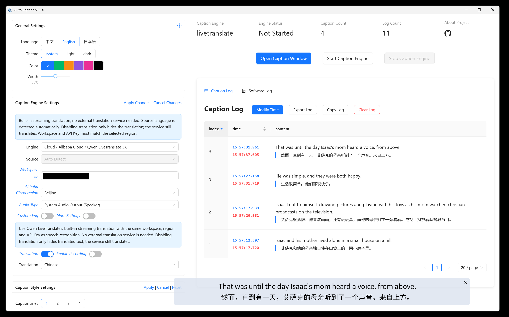
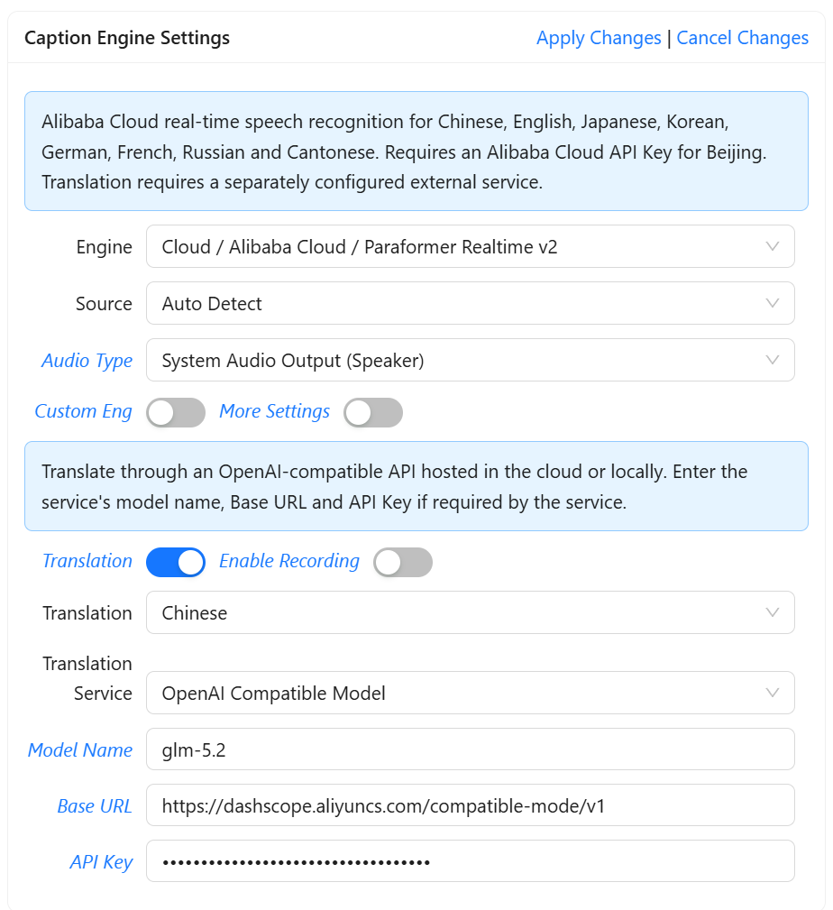
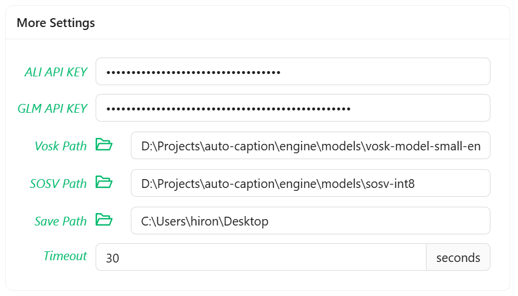
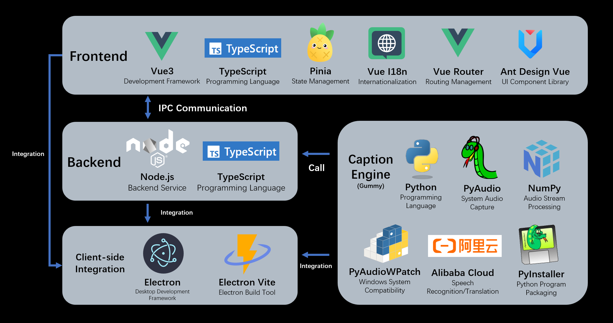

<div align="center" >
    
    <h1 align="center">auto-caption</h1>
    <p>Auto Caption is cross-platform software for displaying real-time captions.</p>
    <p>
      <a href="https://github.com/HiMeditator/auto-caption/releases"></a>
      <a href="https://github.com/HiMeditator/auto-caption/issues"></a>
      
      
      
    </p>
    <p>
        | <a href="./README.md">简体中文</a>
        | <b>English</b>
        | <a href="./README_ja.md">日本語</a> |
    </p>
    <p><i>Current software version: v1.2.0. See the <a href="./docs/CHANGELOG.md">changelog</a> for updates.</i></p>
</div>



## 📥 Download

Software Download: [GitHub Releases](https://github.com/HiMeditator/auto-caption/releases)

Vosk Model Download: [Vosk Models](https://alphacephei.com/vosk/models)

SOSV Model Download: [Shepra-ONNX SenseVoice Model](https://github.com/HiMeditator/auto-caption/releases/tag/sosv-model)

## 📚 Documentation

[Standalone Engine Usage and Build Guide (Chinese)](./engine/README.md)

[Auto Caption User Manual](./docs/user-manual/en.md)

[Caption Engine Documentation](./docs/engine-manual/en.md)

[Changelog](./docs/CHANGELOG.md)

## 👁️‍🗨️ Preview

https://github.com/user-attachments/assets/9c188d78-9520-4397-bacf-4c8fdcc54874

## ✨ Features

- Generate captions from audio output or microphone input
- Supports calling local Ollama models, cloud-based OpenAI compatible models, or cloud-based Google Translate API for translation
- Cross-platform (Windows, macOS, Linux) and multi-language interface (Chinese, English, Japanese) support
- Rich caption style settings (font, font size, font weight, font color, background color, etc.)
- Flexible caption engine selection (Aliyun Paraformer cloud model, GLM-ASR cloud model, local Vosk model, local SOSV model, or you can develop your own model)
- Multi-language recognition and translation (see below "⚙️ Built-in Speech Recognition Models")
- Subtitle record display and export (supports exporting `.srt` and `.json` formats)

## 📖 Basic Usage

The software has been adapted for Windows, macOS, and Linux platforms. The tested platform information is as follows:

| OS Version         | Architecture | System Audio Input | System Audio Output |
| ------------------ | ------------ | ------------------ | ------------------- |
| Windows 11 24H2    | x64          | ✅                 | ✅                   |
| macOS Sequoia 15.5 | arm64        | ✅ [Additional config required](./docs/user-manual/en.md#capturing-system-audio-output-on-macos) | ✅        |
| Ubuntu 24.04.2     | x64          | ✅                 | ✅                   |

Additional configuration is required to capture system audio output on macOS and Linux platforms. See [Auto Caption User Manual](./docs/user-manual/en.md) for details.

After downloading the software, you need to select the corresponding model according to your needs and then configure the model.

|                                                              | Accuracy | Real-time | Deployment Type | Supported Languages | Translation | Notes |
| ------------------------------------------------------------ | -------- | --------- | --------------- | ------------------- | ----------- | ----- |
| [Qwen LiveTranslate 3.8](https://help.aliyun.com/zh/model-studio/qwen3-8-livetranslate-flash-realtime) | Very good 😊 | Very good 😊 | Cloud / Alibaba Cloud | Auto detection | Built-in translation | Paid; see the model link for pricing |
| [Paraformer Realtime v2](https://help.aliyun.com/zh/model-studio/paraformer-real-time-speech-recognition-python-sdk) | Very good 😊 | Very good 😊 | Cloud / Alibaba Cloud | 8 languages including Cantonese | Requires additional configuration | Paid, approximately 0.864 CNY/hour |
| [glm-asr-2512](https://docs.bigmodel.cn/cn/guide/models/sound-and-video/glm-asr-2512) | Very good 😊 | Poor 😞 | Cloud / Zhipu AI | 4 languages | Requires additional configuration | Paid, approximately 0.72 CNY/hour |
| [Vosk](https://alphacephei.com/vosk) | Poor 😞 | Very good 😊 | Local / CPU | Over 30 languages | Requires additional configuration | Supports many languages |
| [SOSV](https://k2-fsa.github.io/sherpa/onnx/sense-voice/index.html) | Average 😐 | Average 😐 | Local / CPU | 5 languages | Requires additional configuration | Only one model |
| Self-developed | 🤔 | 🤔 | Custom | Custom | Custom | Develop your own using Python according to the [documentation](./docs/engine-manual/en.md) |

Qwen LiveTranslate includes translation; other caption engines require an external translation service when translation is enabled.

### Configuring Translation Models



> Note: Translation is not real-time. The translation model is only called after each sentence recognition is completed.

#### Ollama Local Model

> Note: Using models with too many parameters will lead to high resource consumption and translation delays. It is recommended to use models with less than 1B parameters, such as: `qwen2.5:0.5b`, `qwen3:0.6b`.

Before using this model, confirm that [Ollama](https://ollama.com/) is installed locally and that the required model has been downloaded. Select `Ollama Local Model` as the translation service and enter the model name; Ollama uses its default local service address.

#### OpenAI Compatible Model

If the local Ollama model's translation quality is unsatisfactory, or you prefer not to install Ollama locally, select `OpenAI-compatible Model` as the translation service and enter its model name, Base URL, and API key separately.

Here are some model provider `Base URL`s:
- OpenAI: https://api.openai.com/v1
- DeepSeek: https://api.deepseek.com
- Alibaba Cloud: https://dashscope.aliyuncs.com/compatible-mode/v1

The API Key needs to be obtained from the corresponding model provider.

#### Google Translate API

> Note: Google Translate API cannot be used in regions without access to the international internet.

No configuration required, just connect to the internet to use.

## ⚙️ Built-in Speech Recognition Models

The software currently includes 5 speech recognition models. Their usage and descriptions are provided below.

#### Using Qwen LiveTranslate

Qwen LiveTranslate uses `qwen3.8-livetranslate-flash-realtime` to stream source transcripts and translated text in one WebSocket session, with no external translation service. Paraformer remains the default. Select this engine, enter the workspace ID and region (Beijing or Singapore), and enter an Alibaba Cloud API Key for that workspace and region in More Settings. Alternatively, use `DASHSCOPE_WORKSPACE_ID` and `DASHSCOPE_API_KEY`. The source language is detected automatically. The UI offers Chinese, English, Japanese, Korean, German, French, Russian, Spanish and Italian as target languages. Audio is uploaded as 16kHz, 16-bit mono PCM. Only text is returned; translated speech is not played. Disabling translation only hides the translation, while the service still translates. Use Paraformer for recognition only.

[API / WebSocket](https://help.aliyun.com/zh/model-studio/qwen3-8-livetranslate-flash-realtime)

#### Using Paraformer Realtime v2

The default engine is Alibaba Cloud `paraformer-realtime-v2`, using the DashScope Recognition SDK for duplex streaming ASR. Audio is uploaded as 16kHz, 16-bit mono PCM. Supported source languages are Chinese, English, Japanese, Korean, German, French, Russian and Cantonese; `auto` sends no language hint. There is no built-in translation: configure Ollama, an OpenAI-compatible service or Google Translate to translate finalized sentences asynchronously. Set the Alibaba Cloud API Key in settings or the `DASHSCOPE_API_KEY` environment variable on any platform; the CLI option is `--dashscope_api_key`. The current endpoint is the default Beijing endpoint and requires a matching regional API Key. Old Gummy selections and API Keys migrate automatically; old Spanish/Italian source selections switch to auto detection. Update old custom commands manually. See the [official SDK documentation](https://help.aliyun.com/zh/model-studio/paraformer-real-time-speech-recognition-python-sdk).

#### Using the GLM-ASR Model

Before using it, you need to obtain an API KEY from the Zhipu AI platform and add it to the software settings.

For API KEY acquisition, see: [Quick Start](https://docs.bigmodel.cn/cn/guide/start/quick-start).

#### Using the Vosk Model

Developed based on [vosk-api](https://github.com/alphacep/vosk-api). This caption engine offers a wide choice of language models (over 30 languages), but recognition accuracy is relatively poor and the generated text has no punctuation.

To use the Vosk local caption engine, first download the model you need from the [Vosk Models](https://alphacephei.com/vosk/models) page, unzip the model locally, and add the path of the model folder to the software settings.



#### Using the SOSV Model

SOSV is an integrated model package, mainly based on [Shepra-ONNX SenseVoice](https://k2-fsa.github.io/sherpa/onnx/sense-voice/index.html), with additional endpoint detection and punctuation restoration models. It supports recognition in English, Chinese, Japanese, Korean, and Cantonese.

The way to use the SOSV model is the same as Vosk. The download address is as follows: https://github.com/HiMeditator/auto-caption/releases/tag/sosv-model

## ⌨️ Using in Terminal

The software adopts a modular design and can be divided into two parts: the main software body and caption engine. The main software calls caption engine through a graphical interface. Audio acquisition and speech recognition functions are implemented in the caption engine, which can be used independently without the main software.

Caption engine is developed using Python and packaged as executable files via PyInstaller. Therefore, there are two ways to use caption engine:

1. Use the source code of the project's caption engine part and run it with a Python environment that has the required libraries installed
2. Run the packaged executable file of the caption engine through the terminal

For source execution, install uv, enter `engine`, and run `uv sync` first. Run the example below in that directory. Packaged executables do not require uv.

For runtime parameters and detailed usage instructions, please refer to the [User Manual](./docs/user-manual/en.md#using-caption-engine-standalone).

```bash
uv run python main.py \
-e paraformer \
--dashscope_api_key sk-******************************** \
--translation_provider ollama \
--translation_model qwen2.5:0.5b \
-a 0 \
-d 1 \
-s en \
-t zh
```


## 🚀 Project Setup



### Install Dependencies

```bash
npm install
```

### Manage and Build the Subtitle Engine

Install [uv](https://docs.astral.sh/uv/getting-started/installation/) first. Engine dependencies are declared in `engine/pyproject.toml`. `engine/.python-version` selects Python 3.12 by default. Fresh clones resolve dependencies again, so versions can differ between developers or builds. Run these commands from the repository root:

```bash
# Synchronize project dependencies
npm run engine:sync
# Run tests
npm run engine:test
# Build the executable
npm run build:engine
```

Electron development mode runs Python directly from this environment; the release version runs the packaged engine and does not require users to install uv or Python.

On macOS, PyAudio requires PortAudio (for example, `brew install portaudio`). Linux audio capture requires `pactl` and `parec` (`pulseaudio-utils` on Ubuntu) and a working PulseAudio server or PipeWire PulseAudio compatibility service. See the [user manual](./docs/user-manual/en.md) for other platform settings.

`build:engine` runs PyInstaller in the uv-managed environment and produces a single executable: `engine/dist/main.exe` on Windows or `engine/dist/main` on macOS/Linux. Installers copy the executable to `resources/engine/main.exe` on Windows or `resources/engine/main` on macOS/Linux.

### Run Project

```bash
npm run dev
```

### Code Checks

Run these commands from the repository root:

```bash
npm run lint
npm run typecheck
```

ESLint checks the desktop JavaScript, TypeScript and Vue source files and build configuration, excluding build outputs, dependency environments, models and experimental directories. The Python engine is outside ESLint's scope.

### Build Project

```bash
# For windows
npm run build:win
# For macOS
npm run build:mac
# For Linux
npm run build:linux
```

These installer commands build the engine before the desktop app. Run each command on its target operating system; PyInstaller does not cross-compile the engine for another OS.

GitHub Actions currently checks and publishes Windows/Linux x64 only; automated macOS builds are temporarily disabled. PRs targeting `main` run code checks, desktop builds and tests. When a push or merge to `main` changes the `package.json` version, successful checks are followed by packaging the Windows NSIS installer (`.exe`) and Linux archive (`.tar.gz`). The GitHub Release is published after both uploads complete.
