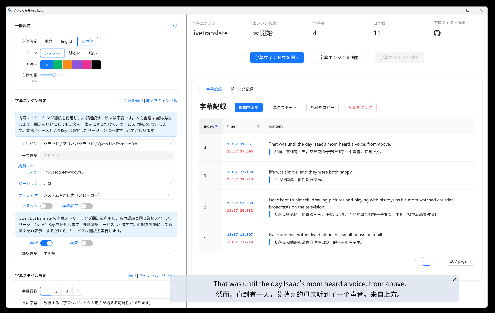
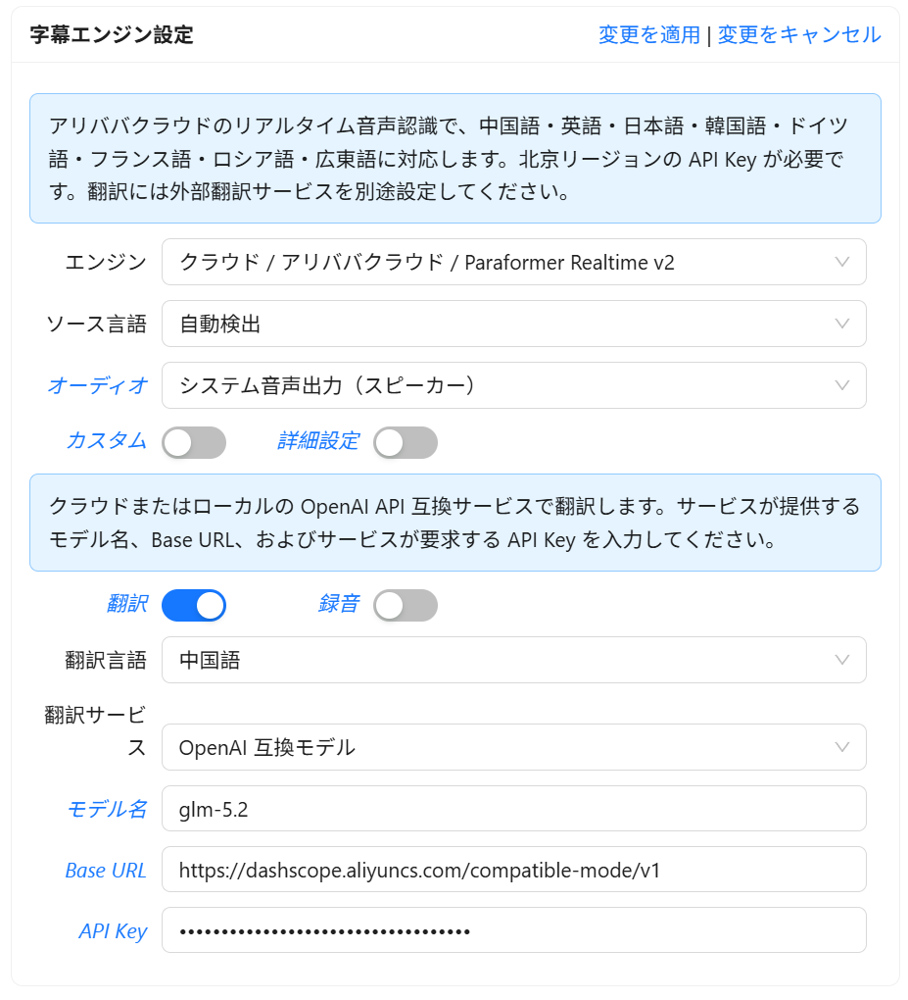
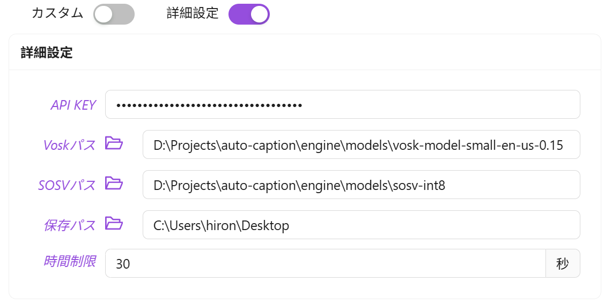
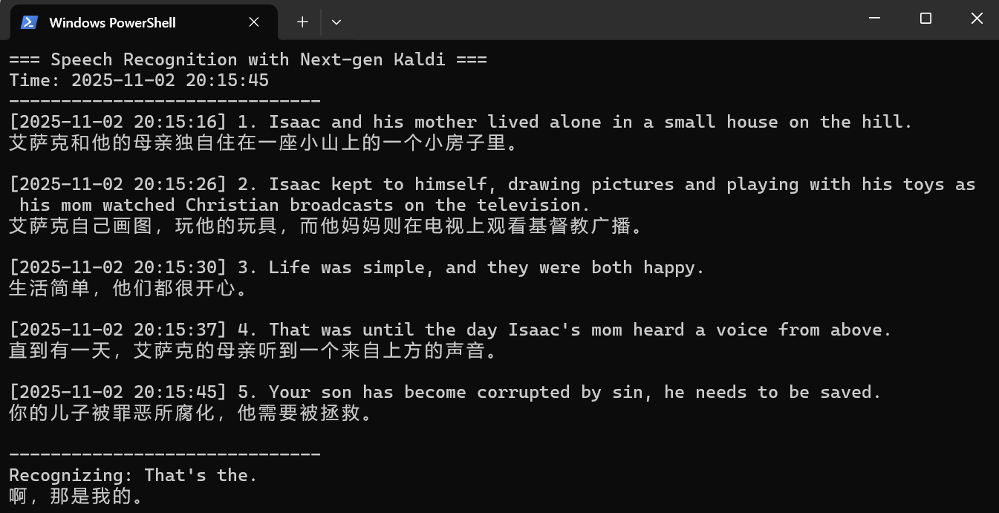
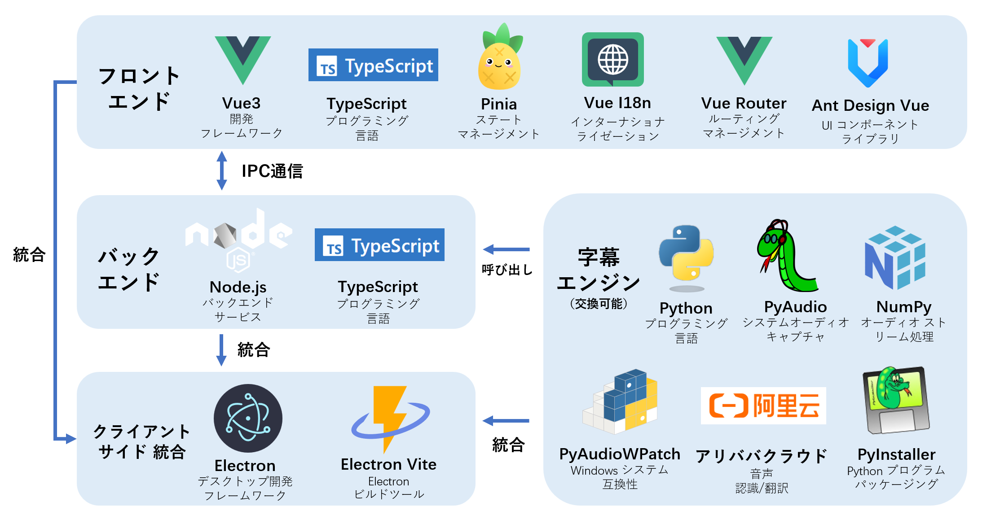

<div align="center" >
    
    <h1 align="center">auto-caption</h1>
    <p>Auto Caption はクロスプラットフォームのリアルタイム字幕表示ソフトウェアです。</p>
    <p>
      <a href="https://github.com/HiMeditator/auto-caption/releases"></a>
      <a href="https://github.com/HiMeditator/auto-caption/issues"></a>
      
      
      
    </p>
    <p>
        | <a href="./README.md">简体中文</a>
        | <a href="./README_en.md">English</a>
        | <b>日本語</b> |
    </p>
    <p><i>現在のソフトウェアバージョン：v1.2.0。更新内容は<a href="./docs/CHANGELOG.md">更新履歴</a>をご覧ください。</i></p>
</div>



## 📥 ダウンロード

ソフトウェアダウンロード: [GitHub Releases](https://github.com/HiMeditator/auto-caption/releases)

Vosk モデルダウンロード: [Vosk Models](https://alphacephei.com/vosk/models)

SOSV モデルダウンロード: [Shepra-ONNX SenseVoice Model](https://github.com/HiMeditator/auto-caption/releases/tag/sosv-model)

## 📚 関連ドキュメント

[字幕エンジンの単独実行と構築（中国語）](./engine/README.md)

[Auto Caption ユーザーマニュアル](./docs/user-manual/ja.md)

[字幕エンジン説明ドキュメント](./docs/engine-manual/ja.md)

[更新履歴](./docs/CHANGELOG.md)

## 👁️‍🗨️ プレビュー

https://github.com/user-attachments/assets/9c188d78-9520-4397-bacf-4c8fdcc54874

## ✨ 特徴

- 音声出力またはマイク入力からの字幕生成
- ローカルのOllamaモデル、クラウド上のOpenAI互換モデル、またはクラウド上のGoogle翻訳APIを呼び出して翻訳を行うことをサポートしています
- クロスプラットフォーム（Windows、macOS、Linux）、多言語インターフェース（中国語、英語、日本語）対応
- 豊富な字幕スタイル設定（フォント、フォントサイズ、フォント太さ、フォント色、背景色など）
- 柔軟な字幕エンジン選択（阿里云Paraformerクラウドモデル、GLM-ASRクラウドモデル、ローカルVoskモデル、ローカルSOSVモデル、または独自にモデルを開発可能）
- 多言語認識と翻訳（下記「⚙️ 字幕エンジン説明」参照）
- 字幕記録表示とエクスポート（`.srt` および `.json` 形式のエクスポートに対応）

## 📖 基本使い方

> ⚠️ 注意：現在、Windowsプラットフォームのソフトウェアの最新バージョンのみがメンテナンスされており、他のプラットフォームの最終バージョンはv1.0.0のままです。

このソフトウェアは Windows、macOS、Linux プラットフォームに対応しています。テスト済みのプラットフォーム情報は以下の通りです：

| OS バージョン | アーキテクチャ | システムオーディオ入力 | システムオーディオ出力 |
| ------------------ | ------------ | ------------------ | ------------------- |
| Windows 11 24H2    | x64          | ✅                 | ✅                   |
| macOS Sequoia 15.5 | arm64        | ✅ [追加設定が必要](./docs/user-manual/ja.md#macos-でのシステムオーディオ出力の取得方法)    | ✅                   |
| Ubuntu 24.04.2     | x64          | ✅                 | ✅                   |
| Kali Linux 2022.3  | x64          | ✅                 | ✅                   |
| Kylin Server V10 SP3 | x64 | ✅ | ✅ |

macOS および Linux プラットフォームでシステムオーディオ出力を取得するには追加設定が必要です。詳細は[Auto Captionユーザーマニュアル](./docs/user-manual/ja.md)をご覧ください。

ソフトウェアをダウンロードした後、自分のニーズに応じて対応するモデルを選択し、モデルを設定する必要があります。

|                                                              | 正確性 | 実時間性 | デプロイタイプ | 対応言語 | 翻訳 | 備考 |
| ------------------------------------------------------------ | -------- | --------- | -------------- | -------- | ---- | ---- |
| [Paraformer Realtime v2](https://help.aliyun.com/zh/model-studio/paraformer-real-time-speech-recognition-python-sdk) | ストリーミング認識 | 外部翻訳 | クラウド / アリババクラウド | 広東語を含む8言語 | Ollama / OpenAI 互換 / Google | アリババクラウドの現行料金 |
| [Qwen LiveTranslate 3.8](https://help.aliyun.com/zh/model-studio/qwen3-5-livetranslate-flash-realtime) | ストリーミング認識 | ストリーミング翻訳 | クラウド / アリババクラウド | 自動検出 | 内蔵翻訳 | API Key + 業務スペース ID、公式料金 |
| [glm-asr-2512](https://docs.bigmodel.cn/cn/guide/models/sound-and-video/glm-asr-2512) | とても良い😊 | 悪い😞 | クラウド / Zhipu AI | 4言語 | 追加設定が必要 | 有料、約0.72元/時間 |
| [Vosk](https://alphacephei.com/vosk) | 悪い😞 | とても良い😊 | ローカル / CPU | 30言語以上 | 追加設定が必要 | 多くの言語に対応 |
| [SOSV](https://k2-fsa.github.io/sherpa/onnx/sense-voice/index.html) | 普通😐 | 普通😐 | ローカル / CPU | 5言語 | 追加設定が必要 | 1つのモデルのみ |
| 自分で開発 | 🤔 | 🤔 | カスタム | カスタム | カスタム | [ドキュメント](./docs/engine-manual/ja.md)に従ってPythonを使用して自分で開発 |

Qwen LiveTranslate は内蔵翻訳を使用し、他の字幕エンジンでは外部翻訳サービスの設定が必要です。

### 翻訳モデルの設定



> 注意：翻訳はリアルタイムではありません。翻訳モデルは各文の認識が完了した後にのみ呼び出されます。

#### Ollama ローカルモデル

> 注意：パラメータ数が多すぎるモデルを使用すると、リソース消費と翻訳遅延が大きくなります。1B未満のパラメータ数のモデルを使用することを推奨します。例：`qwen2.5:0.5b`、`qwen3:0.6b`。

このモデルを使用する前に、ローカルマシンに [Ollama](https://ollama.com/) がインストールされ、必要なモデルがダウンロード済みであることを確認してください。翻訳サービスで「Ollama ローカルモデル」を選択し、モデル名を入力します。Ollama はデフォルトのローカルサービスアドレスを使用します。

#### OpenAI互換モデル

ローカルの Ollama モデルが適さない場合は、翻訳サービスで「OpenAI 互換モデル」を選択し、モデル名、Base URL、API Key を個別に入力します。

いくつかのモデルプロバイダの「Base URL」：
- OpenAI: https://api.openai.com/v1
- DeepSeek: https://api.deepseek.com
- アリババクラウド: https://dashscope.aliyuncs.com/compatible-mode/v1

API Keyは対応するモデルプロバイダから取得する必要があります。

#### Google翻訳API

> 注意：Google翻訳APIは一部の地域では使用できません。

設定不要で、ネット接続があれば使用できます。

### Qwen LiveTranslate

Qwen LiveTranslate は `qwen3.8-livetranslate-flash-realtime` を使用し、1つの WebSocket セッションで原文と訳文をストリーミング出力します。外部翻訳サービスは不要です。デフォルトは Paraformer のままです。このエンジンを選択し、業務スペース ID とリージョン（北京・シンガポール）を設定し、詳細設定で同じ業務スペース・リージョンの API Key を入力してください。`DASHSCOPE_WORKSPACE_ID` と `DASHSCOPE_API_KEY` 環境変数も利用できます。入力言語は自動検出します。UI の翻訳先は中国語・英語・日本語・韓国語・ドイツ語・フランス語・ロシア語・スペイン語・イタリア語です。16kHz・16bit・モノラル PCM を送信し、文字のみを出力します。翻訳音声は再生しません。翻訳を無効にしても訳文を非表示にするだけで、サービスは翻訳を実行します。認識のみが必要な場合は Paraformer を選択してください。

[API / WebSocket](https://help.aliyun.com/zh/model-studio/qwen3-5-livetranslate-flash-realtime)

```bash
uv run python main.py -e livetranslate -t zh --dashscope_api_key <api-key> --dashscope_workspace_id <workspace-id> --dashscope_region cn-beijing
```

### Paraformer Realtime v2

デフォルトエンジンはアリババクラウドの `paraformer-realtime-v2` です。DashScope Recognition SDK の双方向ストリーミング認識を使用し、16kHz・16bit・モノラル PCM を送信します。中国語、英語、日本語、韓国語、ドイツ語、フランス語、ロシア語、広東語に対応し、`auto` は言語ヒントを指定しません。内蔵翻訳はありません。翻訳を有効にする場合は Ollama、OpenAI 互換サービス、Google 翻訳を設定してください。確定した文を非同期で翻訳します。設定または全プラットフォームで利用できる `DASHSCOPE_API_KEY` 環境変数に API Key を指定します。CLI は `--dashscope_api_key` を使用します。現在は北京リージョンのデフォルト接続先を使用するため、同リージョンの API Key が必要です。旧 Gummy の選択と API Key は自動移行し、スペイン語・イタリア語の入力言語は自動検出に変更します。旧カスタムコマンドは手動で更新してください。[公式 SDK ドキュメント](https://help.aliyun.com/zh/model-studio/paraformer-real-time-speech-recognition-python-sdk)を参照してください。

### GLM-ASR モデルの使用

使用前に、Zhipu AI プラットフォームから API キーを取得し、それをソフトウェアの設定に追加する必要があります。

API キーの取得についてはこちらをご覧ください：[クイックスタート](https://docs.bigmodel.cn/ja/guide/start/quick-start)。

### Voskモデルの使用

> Voskモデルの認識効果は不良のため、注意して使用してください。

Voskローカル字幕エンジンを使用するには、まず[Vosk Models](https://alphacephei.com/vosk/models)ページから必要なモデルをダウンロードし、ローカルにモデルを解凍し、モデルフォルダのパスをソフトウェア設定に追加してください。



### SOSVモデルの使用

SOSVモデルの使用方法はVoskと同じで、ダウンロードアドレスは以下の通りです：https://github.com/HiMeditator/auto-caption/releases/tag/sosv-model

## ⌨️ ターミナルでの使用

ソフトウェアはモジュール化設計を採用しており、ソフトウェア本体と字幕エンジンの2つの部分に分けることができます。ソフトウェア本体はグラフィカルインターフェースを通じて字幕エンジンを呼び出します。コアとなる音声取得および音声認識機能はすべて字幕エンジンに実装されており、字幕エンジンはソフトウェア本体から独立して単独で使用できます。

字幕エンジンはPythonを使用して開発され、PyInstallerによって実行可能ファイルとしてパッケージ化されます。したがって、字幕エンジンの使用方法は以下の2つがあります：

1. プロジェクトの字幕エンジン部分のソースコードを使用し、必要なライブラリがインストールされたPython環境で実行する
2. パッケージ化された字幕エンジンの実行可能ファイルをターミナルから実行する

ソースから実行する場合は uv をインストールし、`engine` ディレクトリで `uv sync` を実行してください。以下の例もこのディレクトリで実行します。配布用実行ファイルには uv は不要です。

実行引数および詳細な使用方法については、[ユーザーマニュアル](./docs/user-manual/ja.md#ソースコードでエンジンを実行する)をご参照ください。

```bash
uv run python main.py \
-e paraformer \
--dashscope_api_key sk-******************************** \
--translation_provider ollama \
--translation_model qwen2.5:0.5b \
-a 0 \
-d 1 \
-s en \
-t zh
```



## ⚙️ 字幕エンジン説明

現在、ソフトウェアには5つの字幕エンジンが搭載されており、新しいエンジンが計画されています。それらの詳細情報は以下の通りです。

### Paraformer Realtime v2

デフォルトエンジンはアリババクラウドの `paraformer-realtime-v2` です。DashScope Recognition SDK の双方向ストリーミング認識を使用し、16kHz・16bit・モノラル PCM を送信します。中国語、英語、日本語、韓国語、ドイツ語、フランス語、ロシア語、広東語に対応し、`auto` は言語ヒントを指定しません。内蔵翻訳はありません。翻訳を有効にする場合は Ollama、OpenAI 互換サービス、Google 翻訳を設定してください。確定した文を非同期で翻訳します。設定または全プラットフォームで利用できる `DASHSCOPE_API_KEY` 環境変数に API Key を指定します。CLI は `--dashscope_api_key` を使用します。現在は北京リージョンのデフォルト接続先を使用するため、同リージョンの API Key が必要です。旧 Gummy の選択と API Key は自動移行し、スペイン語・イタリア語の入力言語は自動検出に変更します。旧カスタムコマンドは手動で更新してください。[公式 SDK ドキュメント](https://help.aliyun.com/zh/model-studio/paraformer-real-time-speech-recognition-python-sdk)を参照してください。

### GLM-ASR 字幕エンジン（クラウド）

https://docs.bigmodel.cn/ja/guide/models/sound-and-video/glm-asr-2512

### Vosk字幕エンジン（ローカル）

[vosk-api](https://github.com/alphacep/vosk-api)をベースに開発。この字幕エンジンの利点は選択可能な言語モデルが非常に多く（30言語以上）、欠点は認識効果が比較的悪く、生成内容に句読点がないことです。

### SOSV 字幕エンジン（ローカル）

[SOSV](https://github.com/HiMeditator/auto-caption/releases/tag/sosv-model)は統合パッケージで、主に[Shepra-ONNX SenseVoice](https://k2-fsa.github.io/sherpa/onnx/sense-voice/index.html)をベースにし、エンドポイント検出モデルと句読点復元モデルを追加しています。このモデルが認識をサポートする言語は：英語、中国語、日本語、韓国語、広東語です。

## 🚀 プロジェクト実行



### 依存関係のインストール

```bash
npm install
```

### 字幕エンジンの管理と構築

まず [uv](https://docs.astral.sh/uv/getting-started/installation/) をインストールしてください。依存関係は `engine/pyproject.toml` で宣言します。`engine/uv.lock` はローカルで自動生成され、Git の対象外でありコミットしません。`engine/.python-version` により既定の Python は 3.12 になります。新しくクローンした環境では依存関係を再解決するため、開発者やビルド間でバージョンが異なる場合があります。以下はリポジトリのルートで実行します：

```bash
npm run engine:sync
npm run engine:test
npm run build:engine
```

`engine:sync` は既存の固定バージョンを優先し、依存設定の変更時にロックファイルを更新して `engine/.venv` を作成・同期します。開発依存の PyInstaller も含み、仮想環境の手動作成や有効化は不要です。Electron の開発版はこの環境の Python を使用し、配布版は同梱されたエンジンを使用するため、ユーザー側の uv や Python は不要です。

macOS の PyAudio には PortAudio が必要です（例：`brew install portaudio`）。Linux の音声取得には `pactl` と `parec`（Ubuntu では `pulseaudio-utils`）、および動作する PulseAudio または PipeWire の PulseAudio 互換サービスが必要です。その他の設定は[ユーザーマニュアル](./docs/user-manual/ja.md)を参照してください。

`build:engine` は uv が管理する環境で PyInstaller を実行し、単一実行ファイルを生成します。Windows は `engine/dist/main.exe`、macOS/Linux は `engine/dist/main` です。Vosk のパスは現在の Python 環境から自動取得するため、`main.spec` の手動修正は不要です。配布アプリ内の配置先は Windows が `resources/engine/main.exe`、macOS/Linux が `resources/engine/main` です（macOS のリソースディレクトリはアプリ内の `Contents/Resources`）。

実行時依存の追加は `uv add --project engine <package>`、開発依存の追加は `uv add --project engine --dev <package>` を使用します。意図的に更新する場合は `uv lock --project engine --upgrade`、続いて `npm run engine:sync` を実行し、依存宣言の変更は `pyproject.toml` にコミットし、ローカルの `uv.lock` はコミットしないでください。ソース配布のメタデータでネイティブ依存が省略される問題を避けるため、Sherpa-ONNX と `sherpa-onnx-core` は同じバージョンに固定しています。更新時は両方のバージョンを変更してください。

### プロジェクト実行

```bash
npm run dev
```

### コードチェック

リポジトリのルートで実行します：

```bash
npm run lint
npm run typecheck
```

ESLint はデスクトップ側の JavaScript、TypeScript、Vue のソースとビルド設定をチェックし、ビルド成果物、依存環境、モデル、実験用ディレクトリを除外します。Python エンジンは ESLint の対象外です。

### プロジェクト構築

```bash
# Windows 用
npm run build:win
# macOS 用
npm run build:mac
# Linux 用
npm run build:linux
```

これらの配布用コマンドは字幕エンジンを先に構築してからデスクトップアプリを構築します。対象の OS 上で実行してください。PyInstaller は別の OS 向けのクロスコンパイルに対応していません。

### GitHub CI / CD

[ワークフロー](./.github/workflows/ci.yml) は、`main` 向けの Pull Request と `main` への push で、Windows・macOS・Linux の ESLint、型チェック、デスクトップビルド、エンジンのオフラインテスト、リリース検出テストを実行します。Node.js 22、Python 3.12、uv を使用し、macOS では PortAudio を自動インストールします。CI では `.npmrc` の 2 つのミラー設定を一時的に除去し、既定の公式配布元を使用します。ローカルのミラー設定は変更しません。パッケージング時は `electron-builder.yml` の Electron ミラー設定を個別に上書きします。

PR のマージを含む `main` への push では、push 全体の前後で `package.json` の `version` を比較します。バージョンが変更され、全プラットフォームのチェックに成功した場合、Python エンジンを含む x64 配布ファイル（Windows NSIS `.exe`、macOS Intel `.dmg`、Linux `.tar.gz`）をビルドします。パッケージ化したエンジンの `--help` 起動チェックも実行します。すべて成功してから `v<version>` タグと GitHub Release を作成し、自動生成したリリースノートと配布ファイルを公開します。`1.3.0-rc.1` などは Pre-release になります。バージョンが同じ場合やブランチの初回作成時は CI のみ実行します。

リリースするには、希望するバージョンで `npm version 1.3.0 --no-git-tag-version` を実行して `package.json` と `package-lock.json` を更新し、更新ログを整備して `main` にマージします。エンジンのバージョンも変更する場合は `engine/pyproject.toml` を更新します。タグの手動作成や PAT は不要で、公開ジョブは組み込みの `GITHUB_TOKEN` の `contents: write` 権限を使用します。リポジトリ・組織の設定で Actions とこの権限を許可し、タグルールでワークフローによる `v*` タグ作成を許可してください。3 つの `Check (...)` ジョブをマージ必須チェックに設定できます。

現在の配布ファイルにはコード署名・macOS 公証・音声モデルを含みません。Linux ではシステムの音声依存関係が別途必要です。Actions の成果物は 14 日間保存します。失敗時は元の実行の Re-run failed jobs で再実行できます。アップロード中断時は下書きを残し、すべてのファイルが揃ってから公開します。同一コミットの公開済み Release はスキップし、同名タグまたはタグ作成前の Release 下書きが別コミットを指す場合はエラーとなるため新しいバージョンを使用してください。後続の push は公開処理をキャンセルせず、タグは常に処理を開始したコミットを指します。
