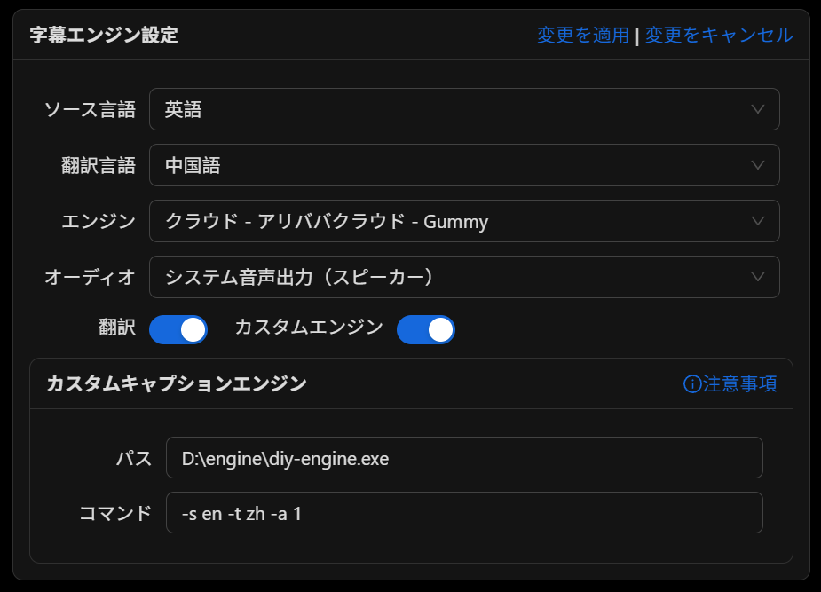

# 字幕エンジン説明ドキュメント

対応バージョン：v1.2.0


## 字幕エンジン紹介

字幕エンジンとは、システムのオーディオ入力（マイク）または出力（スピーカー）のストリーミングデータをリアルタイムで取得し、音声を文字に変換するモデルを呼び出して対応する字幕を生成するサブプログラムです。生成された字幕はJSON形式の文字列データに変換され、標準出力を介してメインプログラムに渡されます（メインプログラムが受け取る文字列が正しくJSONオブジェクトとして解釈できる必要があります）。メインプログラムは字幕データを読み取り、解釈して処理した後、ウィンドウに表示します。

**字幕エンジンプロセスとElectronメインプロセス間の通信は、[caption engine api-doc](../api-docs/caption-engine.md)に準拠しています。**

## 実行フロー

メインプロセスと字幕エンジンの通信フロー：

### エンジンの起動

- メインプロセス：`child_process.spawn()`を使用して字幕エンジンプロセスを起動
- 字幕エンジンプロセス：TCP Socketサーバースレッドを作成し、作成後に標準出力にJSONオブジェクトを文字列化して出力。このオブジェクトには`command`フィールドが含まれ、値は`connect`
- メインプロセス：字幕エンジンプロセスの標準出力を監視し、標準出力を行ごとに分割してJSONオブジェクトとして解析し、オブジェクトの`command`フィールドの値が`connect`かどうかを判断。`connect`の場合はTCP Socketサーバーに接続

### 字幕認識

- 字幕エンジンプロセス：メインスレッドでシステムオーディオ出力を監視し、オーディオデータブロックを字幕エンジンに送信して解析。字幕エンジンはオーディオデータブロックを解析し、標準出力を介して解析された字幕データオブジェクト文字列を送信
- メインプロセス：字幕エンジンの標準出力を引き続き監視し、解析されたオブジェクトの`command`フィールドに基づいて異なる操作を実行

### エンジンの停止

- メインプロセス：ユーザーがフロントエンドで字幕エンジンを停止する操作を実行すると、メインプロセスはSocket通信を介して字幕エンジンプロセスに`command`フィールドが`stop`のオブジェクト文字列を送信
- 字幕エンジンプロセス：メインエンジンプロセスから送信された字幕データオブジェクト文字列を受信し、文字列をオブジェクトとして解析。オブジェクトの`command`フィールドが`stop`の場合、グローバル変数`shared_data.status`の値を`stop`に設定
- 字幕エンジンプロセス：メインスレッドでシステムオーディオ出力をループ監視し、`shared_data.status`の値が`running`でない場合、ループを終了し、リソースを解放して実行を終了
- メインプロセス：字幕エンジンプロセスの終了を検出した場合、対応する処理を実行し、フロントエンドにフィードバック

## プロジェクトで実装済みの機能

以下の機能はすでに実装されており、直接再利用できます。

### 標準出力

通常情報、コマンド、エラー情報を出力できます。

サンプル：

```python
from utils import stdout, stdout_cmd, stdout_obj, stderr
stdout("Hello") # {"command": "print", "content": "Hello"}\n
stdout_cmd("connect") # {"command": "connect", "content": ""}\n
stdout_obj({"command": "print", "content": "Hello"})
stderr("Error Info")
```

### Socketサービスの作成

このSocketサービスは指定されたポートを監視し、Electronメインプログラムから送信された内容を解析し、`shared_data.status`の値を変更する可能性があります。

サンプル：

```python
import threading
import time
from utils import start_server, shared_data

port = 8080
threading.Thread(target=start_server, args=(port,), daemon=True).start()
while shared_data.status == 'running':
    time.sleep(0.1)
```

### オーディオ取得

`AudioStream`クラスはオーディオデータを取得するために使用され、Windows、Linux、macOSでクロスプラットフォームで実装されています。このクラスの初期化には2つのパラメータが含まれます：

- `audio_type`：取得するオーディオのタイプ。0はシステム出力オーディオ（スピーカー）、1はシステム入力オーディオ（マイク）
- `chunk_rate`：オーディオデータの取得頻度。1秒あたりに取得するオーディオブロックの数

このクラスには次のメソッドがあります：

- `open_stream()`：オーディオ取得を開始
- `read_chunk() -> bytes`：1つのオーディオブロックを読み取り
- `close_stream()`：オーディオ取得を閉じる
- `close_stream_signal()`：スレッドから安全にオーディオ取得を終了

サンプル：

```python
from sysaudio import AudioStream
from utils import shared_data

stream = AudioStream(0, 20)
stream.open_stream()
try:
    while shared_data.status == 'running':
        data = stream.read_chunk()
        if data is None:
            continue
        # Process the audio chunk here.
finally:
    stream.close_stream()
```

### オーディオ処理

取得したオーディオストリームは、文字に変換する前に前処理が必要な場合があります。一般的に、マルチチャンネルオーディオをシングルチャンネルオーディオに変換し、リサンプリングが必要な場合もあります。このプロジェクトでは、次の2つのオーディオ処理関数を提供しています：

- `merge_chunk_channels(chunk: bytes, channels: int) -> bytes`：マルチチャンネルオーディオブロックをシングルチャンネルオーディオブロックに変換
- `resample_chunk_mono(chunk: bytes, channels: int, orig_sr: int, target_sr: int) -> bytes`：現在のマルチチャンネルオーディオデータブロックをシングルチャンネルオーディオデータブロックに変換し、リサンプリングを実行

## 字幕エンジンで実装が必要な機能

### オーディオから文字への変換

適切なオーディオストリームを取得した後、オーディオストリームを文字に変換する必要があります。一般的に、さまざまなモデル（クラウドまたはローカル）を使用してオーディオストリームを文字に変換します。要件に応じて適切なモデルを選択する必要があります。

この部分はクラスとしてカプセル化することをお勧めします。以下の4つのメソッドを実装する必要があります：

- `start(self)`：モデルを起動
- `send_audio_frame(self, data: bytes)`：現在のオーディオブロックデータを処理し、**生成された字幕データを標準出力を介してElectronメインプロセスに送信**
- `translate(self)`：`shared_data.chunk_queue` から音声チャンクを取得し、`send_audio_frame` に渡す
- `stop(self)`：モデルを停止

完全な字幕エンジンの実例：

- [paraformer.py](../../engine/audio2text/paraformer.py)
- [livetranslate.py](../../engine/audio2text/livetranslate.py)
- [glm.py](../../engine/audio2text/glm.py)
- [vosk.py](../../engine/audio2text/vosk.py)
- [sosv.py](../../engine/audio2text/sosv.py)

### 字幕翻訳

一部の音声認識モデルは内蔵翻訳を提供していません。既存の翻訳関数を再利用できます。翻訳結果の time_s は元の字幕と一致させてください。

```python
from utils import google_translate, ollama_translate, openai_translate
text = "これは翻訳テストです。"
google_translate("", "en", text, "12:34:56.100")
ollama_translate("qwen3:0.6b", "en", text, "12:34:56.100")
openai_translate("gpt-4.1-mini", "en", text, "12:34:56.100", "https://api.openai.com/v1", "<api-key>")
```

### 字幕データの送信

現在のオーディオストリームのテキストを取得した後、そのテキストをメインプログラムに送信する必要があります。字幕エンジンプロセスは標準出力を介して字幕データをElectronメインプロセスに渡します。

送信する内容はJSON文字列でなければなりません。JSONオブジェクトには以下のパラメータを含める必要があります：

```typescript
export interface CaptionItem {
  command: "caption",
  index: number, // 字幕のシーケンス番号
  time_s: string, // 現在の字幕の開始時間
  time_t: string, // 現在の字幕の終了時間
  text: string, // 字幕の内容
  translation: string // 字幕の翻訳
}
```

**JSONデータを出力するたびにバッファをフラッシュし、electronメインプロセスが受信する文字列が常にJSONオブジェクトとして解釈できるようにする必要があります。**

プロジェクトで既に実装されている`stdout_obj`関数を使用して送信することをお勧めします。

### コマンドラインパラメータの指定

カスタム字幕エンジンの設定はコマンドラインパラメータで指定するため、字幕エンジンのパラメータを設定する必要があります。このプロジェクトで現在使用されているパラメータは以下のとおりです：

```python
import argparse

if __name__ == "__main__":
    parser = argparse.ArgumentParser(description='Convert system audio stream to text')
    # all
    parser.add_argument('-e', '--caption_engine', default='paraformer', choices=['paraformer', 'livetranslate', 'glm', 'vosk', 'sosv'], help='Caption engine: paraformer, livetranslate, glm, vosk or sosv')
    parser.add_argument('-a', '--audio_type', type=int, default=0, help='Audio stream source: 0 for output, 1 for input')
    parser.add_argument('-c', '--chunk_rate', type=int, default=10, help='Number of audio stream chunks collected per second')
    parser.add_argument('-p', '--port', type=int, default=0, help='The port to run the server on, 0 for no server')
    parser.add_argument('-d', '--display_caption', type=int, default=0, help='Display caption on terminal, 0 for no display, 1 for display')
    parser.add_argument('-t', '--target_language', default='none', help='Target language code, "none" for no translation')
    parser.add_argument('-r', '--record', type=int, default=0, help='Whether to record the audio, 0 for no recording, 1 for recording')
    parser.add_argument('-rp', '--record_path', default='', help='Path to save the recorded audio')
    # paraformer and sosv and glm
    parser.add_argument('-s', '--source_language', default='auto', help='Source language code')
    # Alibaba Cloud engines
    parser.add_argument('--dashscope_api_key', default='', help='API key for Alibaba Cloud caption engines')
    parser.add_argument('--dashscope_workspace_id', default='', help='LiveTranslate workspace ID (or DASHSCOPE_WORKSPACE_ID)')
    parser.add_argument('--dashscope_region', choices=['cn-beijing', 'ap-southeast-1'], default='cn-beijing', help='LiveTranslate API region')
    # External translation: Paraformer, GLM, Vosk and SOSV
    parser.add_argument('--translation_provider', choices=['ollama', 'openai', 'google'], default='ollama', help='Translation service provider')
    parser.add_argument('--translation_model', default='', help='Translation model name (for Ollama or OpenAI-compatible services)')
    parser.add_argument('--translation_base_url', default='', help='OpenAI-compatible API base URL')
    parser.add_argument('--translation_api_key', default='', help='OpenAI-compatible API key')
    # vosk only
    parser.add_argument('-vosk', '--vosk_model', default='', help='The path to the vosk model.')
    # sosv only
    parser.add_argument('-sosv', '--sosv_model', default=None, help='The SenseVoice model path')
    # glm only
    parser.add_argument('-gurl', '--glm_url', default='https://open.bigmodel.cn/api/paas/v4/audio/transcriptions', help='GLM API URL')
    parser.add_argument('-gmodel', '--glm_model', default='glm-asr-2512', help='GLM Model Name')
    parser.add_argument('-gkey', '--glm_api_key', default='', help='GLM API Key')

    args = parser.parse_args()
```

たとえば、このプロジェクトの字幕エンジンでParaformerモデルを使用し、原文を日本語、翻訳を中国語に指定し、システムオーディオ出力の字幕を取得し、毎回0.1秒のオーディオデータをキャプチャする場合、コマンドラインパラメータは以下のようになります：

```bash
uv run python main.py -e paraformer -s ja -t zh -a 0 -c 10 --dashscope_api_key <dashscope-api-key> --translation_provider ollama --translation_model qwen2.5:0.5b
```

## その他

### 通信規格

[caption engine api-doc](../api-docs/caption-engine.md)

### プログラムエントリ

[main.py](../../engine/main.py)

### 開発の推奨事項

オーディオから文字への変換以外は、このプロジェクトのコードを直接再利用することをお勧めします。その場合、追加する必要がある内容は：

- `engine/audio2text/`：新しいオーディオから文字への変換クラスを追加（ファイルレベル）
- `engine/main.py`：新しいパラメータ設定とプロセス関数を追加（`main_paraformer`関数と`main_vosk`関数を参照）

### パッケージ化

エンジンの依存関係は uv で管理します。`engine/pyproject.toml` は実行時依存と開発依存の PyInstaller、`engine/uv.lock` はローカルで自動生成し、Git の対象外とします。既定の Python は 3.12 です。リポジトリのルートで実行してください：

```bash
npm run engine:sync
npm run engine:test
npm run build:engine
```

`engine` ディレクトリでは `uv run pyinstaller --noconfirm --clean main.spec` も使用できます。Vosk のパスは現在の環境から自動取得します。生成される単一実行ファイルは Windows が `engine/dist/main.exe`、macOS/Linux が `engine/dist/main` です。配布アプリのリソース内ではそれぞれ `engine/main.exe`、`engine/main` に配置し、メインプロセスの起動パスと一致させます。配布用コマンドはエンジンを先に構築するため、対象の OS 上で実行してください。音声取得のシステム依存は README を参照してください。配布版には uv や Python のインストールは不要です。

### 実行

使用可能な字幕エンジンを取得したら、字幕ソフトウェアウィンドウで字幕エンジンのパスと字幕エンジンの実行コマンド（パラメータ）を指定して字幕エンジンを起動できます。



デフォルトエンジンはアリババクラウドの `paraformer-realtime-v2` です。DashScope Recognition SDK の双方向ストリーミング認識を使用し、16kHz・16bit・モノラル PCM を送信します。中国語、英語、日本語、韓国語、ドイツ語、フランス語、ロシア語、広東語に対応し、`auto` は言語ヒントを指定しません。内蔵翻訳はありません。翻訳を有効にする場合は Ollama、OpenAI 互換サービス、Google 翻訳を設定してください。確定した文を非同期で翻訳します。設定または全プラットフォームで利用できる `DASHSCOPE_API_KEY` 環境変数に API Key を指定します。CLI は `--dashscope_api_key` を使用します。現在は北京リージョンのデフォルト接続先を使用するため、同リージョンの API Key が必要です。旧 Gummy の選択と API Key は自動移行し、スペイン語・イタリア語の入力言語は自動検出に変更します。旧カスタムコマンドは手動で更新してください。[公式 SDK ドキュメント](https://help.aliyun.com/zh/model-studio/paraformer-real-time-speech-recognition-python-sdk)を参照してください。

## Qwen LiveTranslate

Qwen LiveTranslate は `qwen3.8-livetranslate-flash-realtime` を使用し、1つの WebSocket セッションで原文と訳文をストリーミング出力します。外部翻訳サービスは不要です。デフォルトは Paraformer のままです。このエンジンを選択し、業務スペース ID とリージョン（北京・シンガポール）を設定し、詳細設定で同じ業務スペース・リージョンの API Key を入力してください。`DASHSCOPE_WORKSPACE_ID` と `DASHSCOPE_API_KEY` 環境変数も利用できます。入力言語は自動検出します。UI の翻訳先は中国語・英語・日本語・韓国語・ドイツ語・フランス語・ロシア語・スペイン語・イタリア語です。16kHz・16bit・モノラル PCM を送信し、文字のみを出力します。翻訳音声は再生しません。翻訳を無効にしても訳文を非表示にするだけで、サービスは翻訳を実行します。認識のみが必要な場合は Paraformer を選択してください。

[API / WebSocket](https://help.aliyun.com/zh/model-studio/qwen3-5-livetranslate-flash-realtime)

```bash
uv run python main.py -e livetranslate -t zh --dashscope_api_key <api-key> --dashscope_workspace_id <workspace-id> --dashscope_region cn-beijing
```
