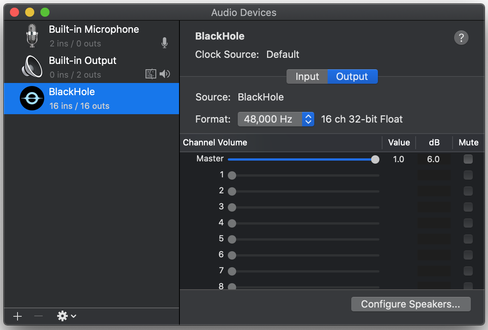
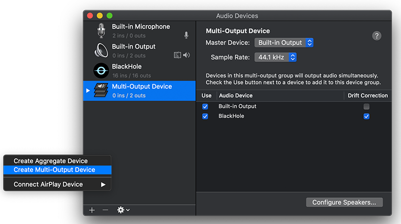
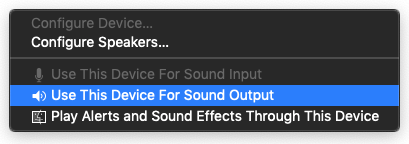

# Auto Caption ユーザーマニュアル

対応バージョン：v1.2.0

## ソフトウェアの概要

Auto Caption は、クロスプラットフォームの字幕表示ソフトウェアで、システムの音声入力（録音）または出力（音声再生）のストリーミングデータをリアルタイムで取得し、音声からテキストに変換するモデルを利用して対応する音声の字幕を生成します。デフォルトの Paraformer エンジンは広東語を含む8言語を認識し、外部サービスで翻訳します。

現在のデフォルト字幕エンジンは Windows、macOS、Linux プラットフォームで完全な機能を有しています。macOSでシステムのオーディオ出力を取得するには追加設定が必要です。

以下のオペレーティングシステムバージョンで正常動作を確認しています。記載以外の OS での正常動作は保証できません。

| OS バージョン        | アーキテクチャ | オーディオ入力取得 | オーディオ出力取得 |
| ------------------- | ------------- | ------------------ | ------------------ |
| Windows 11 24H2     | x64           | ✅                  | ✅                  |
| macOS Sequoia 15.5  | arm64         | ✅ 追加設定が必要      | ✅                  |
| Ubuntu 24.04.2      | x64           | ✅                  | ✅                  |
| Kali Linux 2022.3   | x64           | ✅                  | ✅                  |
| Kylin Server V10 SP3 | x64 | ✅ | ✅ |


### プロジェクト情報

メイン画面の「プロジェクト情報」の下にある GitHub アイコンをクリックすると、情報ウィンドウが開きます。上部にソフトウェアのアイコンを表示し、ソフトウェアバージョン、更新日、作者と、プロジェクトリポジトリ、ユーザーマニュアル、字幕エンジンマニュアル、更新履歴へのリンクを2行2列のカードで提供します。各リンクには完全なアドレスを表示します。マニュアルのリンクは表示言語に合わせて切り替わり、更新履歴は共通の更新記録を参照します。配色はライト・ダークテーマに対応します。作者名 [HiMeditator](https://github.com/HiMeditator) をクリックすると、既定のブラウザで作者の GitHub プロフィールが開きます。

### ソフトウェアの欠点

Paraformer 字幕エンジンを使用するには、アリババクラウドの API KEY を取得する必要があります。

macOS プラットフォームでオーディオ出力を取得するには追加の設定が必要です。

ソフトウェアは Electron で構築されているため、そのサイズは避けられないほど大きいです。

## Paraformer Realtime v2

デフォルトエンジンはアリババクラウドの `paraformer-realtime-v2` です。DashScope Recognition SDK の双方向ストリーミング認識を使用し、16kHz・16bit・モノラル PCM を送信します。中国語、英語、日本語、韓国語、ドイツ語、フランス語、ロシア語、広東語に対応し、`auto` は言語ヒントを指定しません。内蔵翻訳はありません。翻訳を有効にする場合は Ollama、OpenAI 互換サービス、Google 翻訳を設定してください。確定した文を非同期で翻訳します。設定または全プラットフォームで利用できる `DASHSCOPE_API_KEY` 環境変数に API Key を指定します。CLI は `--dashscope_api_key` を使用します。現在は北京リージョンのデフォルト接続先を使用するため、同リージョンの API Key が必要です。旧 Gummy の選択と API Key は自動移行し、スペイン語・イタリア語の入力言語は自動検出に変更します。旧カスタムコマンドは手動で更新してください。[公式 SDK ドキュメント](https://help.aliyun.com/zh/model-studio/paraformer-real-time-speech-recognition-python-sdk)を参照してください。

## Qwen LiveTranslate

Qwen LiveTranslate は `qwen3.8-livetranslate-flash-realtime` を使用し、1つの WebSocket セッションで原文と訳文をストリーミング出力します。外部翻訳サービスは不要です。デフォルトは Paraformer のままです。このエンジンを選択し、業務スペース ID とリージョン（北京・シンガポール）を設定し、詳細設定で同じ業務スペース・リージョンの API Key を入力してください。`DASHSCOPE_WORKSPACE_ID` と `DASHSCOPE_API_KEY` 環境変数も利用できます。入力言語は自動検出します。UI の翻訳先は中国語・英語・日本語・韓国語・ドイツ語・フランス語・ロシア語・スペイン語・イタリア語です。16kHz・16bit・モノラル PCM を送信し、文字のみを出力します。翻訳音声は再生しません。翻訳を無効にしても訳文を非表示にするだけで、サービスは翻訳を実行します。認識のみが必要な場合は Paraformer を選択してください。

[API / WebSocket](https://help.aliyun.com/zh/model-studio/qwen3-5-livetranslate-flash-realtime)

```bash
uv run python main.py -e livetranslate -t zh --dashscope_api_key <api-key> --dashscope_workspace_id <workspace-id> --dashscope_region cn-beijing
```

## GLM エンジン使用前の準備

まずAPI KEYを取得する必要があります。参考：[クイックスタート](https://docs.bigmodel.cn/en/guide/start/quick-start)。

## Voskエンジン使用前の準備

Voskローカル字幕エンジンを使用するには、まず[Vosk Models](https://alphacephei.com/vosk/models)ページから必要なモデルをダウンロードしてください。その後、ダウンロードしたモデルパッケージをローカルに解凍し、対応するモデルフォルダのパスをソフトウェア設定に追加します。


## SOSVモデルの使用

SOSVモデルの使用方法はVoskと同じで、ダウンロードアドレスは以下の通りです：https://github.com/HiMeditator/auto-caption/releases/tag/sosv-model

## macOS でのシステムオーディオ出力の取得方法

> [マルチ出力デバイスの設定](https://github.com/ExistentialAudio/BlackHole/wiki/Multi-Output-Device) チュートリアルに基づいて作成


字幕エンジンは macOS プラットフォームで直接システムオーディオ出力を取得できず、追加のドライバーインストールが必要です。現在の字幕エンジンでは [BlackHole](https://github.com/ExistentialAudio/BlackHole) を使用しています。まずターミナルを開き、以下のいずれかのコマンドを実行してください（最初のオプションを推奨します）：

```bash
brew install blackhole-2ch
brew install blackhole-16ch
brew install blackhole-64ch
```



インストール完了後、`オーディオMIDI設定`（`cmd + space`で検索可能）を開きます。デバイスリストにBlackHoleが表示されているか確認してください - 表示されていない場合はコンピュータを再起動してください。



BlackHoleのインストールが確認できたら、`オーディオ MIDI 設定`ページで左下のプラス(+)ボタンをクリックし、「マルチ出力デバイスを作成」を選択します。出力に BlackHole と希望するオーディオ出力先の両方を含めてください。最後に、このマルチ出力デバイスをデフォルトのオーディオ出力デバイスに設定します。



これで字幕エンジンがシステムオーディオ出力をキャプチャし、字幕を生成できるようになります。

## Linux でシステムオーディオ出力を取得する

まずターミナルで以下を実行してください:

```bash
pactl list short sources
```

以下のような出力が確認できれば追加設定は不要です:

```bash
220     alsa_output.pci-0000_02_02.0.3.analog-stereo.monitor    PipeWire        s16le 2ch 48000Hz       SUSPENDED
221     alsa_input.pci-0000_02_02.0.3.analog-stereo     PipeWire        s16le 2ch 48000Hz       SUSPENDED
```

それ以外の場合は、以下のコマンドで`pulseaudio`と`pavucontrol`をインストールしてください:

```bash
# Debian/Ubuntu系の場合
sudo apt install pulseaudio pavucontrol
# CentOS系の場合
sudo yum install pulseaudio pavucontrol
```

## ソフトウェアの使い方

### 設定の変更

字幕の設定は3つのカテゴリーに分かれます：一般的な設定、字幕エンジンの設定、字幕スタイルの設定。注意すべき点として、一般的な設定の変更は即座に適用されます。しかし、他の2つの設定については、変更後に該当する設定モジュール右上の「適用」オプションをクリックすることで初めて変更が有効になります。「変更を取り消す」を選択すると、現在の変更は保存されず、前回の状態に戻ります。

字幕スタイルのプレビュー右上に、字幕ウィンドウと同じスタイルの閉じるアイコンがあり、原文字幕の文字色を使用します。クリックするとプレビューをすぐに非表示にし、字幕スタイル設定の「プレビュー」スイッチもオフにします。通知でプレビューを閉じたことと、字幕スタイル設定で再表示できることを案内します。スイッチをオンにすると再表示できます。「適用」でこの設定を保存し、「キャンセル」で前回保存した状態に戻します。

### 字幕の開始と停止

すべての設定を完了したら、インターフェースの「字幕エンジンを開始」ボタンをクリックして字幕を開始できます。独立した字幕表示ウィンドウが必要な場合は、インターフェースの「字幕ウィンドウを開く」ボタンをクリックして独立した字幕表示ウィンドウをアクティブ化します。字幕認識を一時停止する必要がある場合は、「字幕エンジンを停止」ボタンをクリックします。

### 字幕表示ウィンドウの調整

下の図は字幕表示ウィンドウです。このウィンドウは現在の最新の字幕をリアルタイムで表示します。ウィンドウの右上にある3つのボタンの機能は、それぞれ字幕表示ウィンドウを閉じる、字幕制御ウィンドウを開く、マウス透過を有効化することです。このウィンドウの幅は調整可能です。マウスをウィンドウの左右の端に移動し、ドラッグして幅を調整します。


### 字幕記録のエクスポート

「エクスポート」ボタンをクリックすると、字幕記録を JSON または SRT ファイル形式で出力できます。

## 字幕エンジン

字幕エンジンは Qwen LiveTranslate 3.8、Paraformer、GLM-ASR、Vosk、SOSV の順に表示し、クラウドモデルを先に並べます。ローカルモデルには実行デバイスを表示します：`ローカル / CPU / Vosk`、`ローカル / CPU / SOSV`。

字幕エンジン設定では、各モデルの説明がモデル設定の先頭に表示され、認識方式・設定要件・翻訳対応を確認できます。モデルを切り替えると説明もすぐに更新されます。説明欄には枠線があり、背景と枠線には現在のテーマカラーに合わせた配色を使用し、ライト・ダークテーマに対応します。

ライトテーマで最後の色（黒）を選択した場合、モデルと翻訳の説明欄には薄いグレーの背景とグレーの枠線を使用し、文字を読みやすく表示します。

モデル、オーディオ、カスタムエンジン、詳細設定を先に表示します。後半では翻訳と録音を同じ行に表示し、その後に翻訳先の言語、翻訳サービスとそのモデル名・Base URL・API Key をまとめて表示します。両グループの間に、モデル説明と同じスタイルの翻訳サービス説明を表示し、Ollama、OpenAI API 互換サービス、Google 翻訳の選択に応じてすぐに更新します。Qwen LiveTranslate では内蔵翻訳の説明を表示し、外部翻訳サービスの設定項目は表示しません。

「オーディオ」「録音」「カスタム」「翻訳」「詳細設定」のラベルにマウスを合わせると、機能や設定要件を確認できます。Qwen LiveTranslate を選択した場合、「業務スペース ID」と「リージョン」にも説明を表示し、業務スペース・API Key・リージョンの一致要件と、業務スペース ID が空欄の場合は環境変数を使用することを案内します。業務スペース ID の説明には[アリババクラウド百煉の業務スペース設定](https://bailian.console.aliyun.com/cn-beijing/settings/workspace)へのリンクもあり、ご自身の業務スペース ID を取得できます。説明付きのラベルはテーマカラーで表示します。Qwen LiveTranslate の翻訳説明には、翻訳を無効にしても訳文を非表示にするだけで、サービスは翻訳を実行することを記載しています。

字幕エンジンとは、システムのオーディオ入力（録音）または出力（再生音）のストリーミングデータをリアルタイムで取得し、音声テキスト変換モデルを呼び出して対応する字幕を生成するサブプログラムです。生成された字幕は JSON 形式の文字列に変換され、標準出力を通じてメインプログラムに渡されます。メインプログラムは字幕データを読み取り、処理した後、ウィンドウに表示します。

ソフトウェアには5つの組み込み字幕エンジンが用意されています。他の字幕エンジンが必要な場合、カスタムエンジンオプションを有効にすることで呼び出すことができます（他のエンジンはこのソフトウェア向けに特別に開発する必要があります）。エンジンパスはコンピュータ上のカスタム字幕エンジンの場所を指し、エンジンコマンドはカスタム字幕エンジンの実行パラメータを表します。これらは該当する字幕エンジンの規則に従って設定する必要があります。


カスタム字幕エンジンを使用する場合、前の字幕エンジンの設定はすべて無効になります。カスタム字幕エンジンの設定は完全にエンジンコマンドによって行われます。

開発者の方で、カスタム字幕エンジンを開発したい場合は、[字幕エンジン説明文書](../engine-manual/ja.md)をご覧ください。

LiveTranslate CLI：`--dashscope_workspace_id` は業務スペース ID（省略時は環境変数）、`--dashscope_region` はリージョン（既定値 `cn-beijing`、`ap-southeast-1` も対応）です。`--dashscope_api_key` は Paraformer と共通です。`-s` は使用せず、`-t none` は訳文の非表示のみです。外部翻訳パラメータは使用しません。

## ソースコードでエンジンを実行する

[uv](https://docs.astral.sh/uv/getting-started/installation/) をインストールし、リポジトリの `engine` ディレクトリで実行します。依存関係は `pyproject.toml` で宣言し、`uv.lock` はローカルで自動生成して Git の対象外とし、既定の Python は 3.12 です。

```bash
cd engine
uv sync
uv run python main.py --help
```

仮想環境の有効化は不要です。認識エンジン、API Key、音声入力、翻訳などの引数を `main.py` の後に指定してください。音声取得のシステム依存は README を参照してください。配布版アプリは同梱された実行ファイルを起動するため、uv や Python のインストールは不要です。自分で構築した単一実行ファイルは Windows が `main.exe`、macOS/Linux が `main` です。

### コマンドライン引数

`uv run python main.py --help` で全引数を確認できます。引数定義と開発例は[字幕エンジン説明](../engine-manual/ja.md)、独立実行・テスト・ビルド手順は[エンジン README（中国語）](../../engine/README.md)も参照してください。

| 引数 | 既定値 | 説明 |
| --- | --- | --- |
| `-e, --caption_engine` | `paraformer` | `paraformer`、`livetranslate`、`glm`、`vosk`、`sosv` |
| `-a, --audio_type` | `0` | `0` はシステム音声出力、`1` はマイク入力 |
| `-c, --chunk_rate` | `10` | 1秒あたりに取得する音声チャンク数 |
| `-p, --port` | `0` | TCP ポート。`0` は Socket サーバーを起動しない |
| `-d, --display_caption` | `0` | 端末表示の指定。`0` は無効、`1` は有効 |
| `-t, --target_language` | `none` | 翻訳先の言語コード。LiveTranslate の `none` は訳文の非表示のみ |
| `-s, --source_language` | `auto` | Paraformer、GLM、SOSV の入力言語。Vosk と LiveTranslate は使用しない |
| `-r, --record` | `0` | `1` で音声を WAV に録音 |
| `-rp, --record_path` | 空欄 | 録音の保存先。空欄は作業ディレクトリ |
| `--dashscope_api_key` | 空欄 | Paraformer と LiveTranslate の API Key。空欄は `DASHSCOPE_API_KEY` を使用 |
| `--dashscope_workspace_id` | 空欄 | LiveTranslate の業務スペース ID。空欄は `DASHSCOPE_WORKSPACE_ID` を使用 |
| `--dashscope_region` | `cn-beijing` | LiveTranslate のリージョン。`ap-southeast-1` も対応 |
| `--translation_provider` | `ollama` | 外部翻訳サービス：`ollama`、`openai`、`google` |
| `--translation_model` | 空欄 | Ollama または OpenAI 互換サービスのモデル名 |
| `--translation_base_url` | 空欄 | OpenAI 互換サービスの Base URL |
| `--translation_api_key` | 空欄 | OpenAI 互換サービスの API Key |
| `-vosk, --vosk_model` | 空欄 | Vosk のモデルディレクトリ |
| `-sosv, --sosv_model` | 未指定 | SOSV のモデルディレクトリ |
| `-gkey, --glm_api_key` | 空欄 | GLM の API Key |
| `-gmodel, --glm_model` | `glm-asr-2512` | GLM のモデル名 |
| `-gurl, --glm_url` | `https://open.bigmodel.cn/api/paas/v4/audio/transcriptions` | GLM の API URL |

業務スペース ID は[アリババクラウド百煉の業務スペース設定](https://bailian.console.aliyun.com/cn-beijing/settings/workspace)で取得できます。業務スペース・API Key・リージョンを一致させてください。Paraformer は北京の既定エンドポイントを使用し、`--dashscope_region` は使用しません。

外部翻訳は Paraformer、GLM、Vosk、SOSV に適用します。翻訳を有効にし、Ollama または OpenAI 互換サービスを選択した場合、モデル名が必須です。OpenAI 互換サービスでは Base URL も必須です。Google 翻訳には追加設定が不要ですが、Google へのネットワーク接続が必要です。LiveTranslate は内蔵翻訳を使用するため、外部翻訳の引数を使用しません。

例：システム音声を日本語で認識し、Ollama で中国語に翻訳します（`engine` ディレクトリで実行）：

```bash
uv run python main.py -e paraformer -a 0 -s ja -t zh --dashscope_api_key <api-key> --translation_provider ollama --translation_model qwen2.5:0.5b
```

Vosk を翻訳なしで使用する例：

```bash
uv run python main.py -e vosk -a 0 -t none -vosk <model-directory>
```

### 単一実行ファイルを使用する

Windows は `main.exe`、macOS/Linux は `./main` の後に同じ引数を指定します。`main.py` と uv は使用しません。ローカルモデルを使用する場合は、別途モデルをダウンロードしてパスを指定してください。Linux と macOS のシステム音声取得には上記の設定が必要です。
